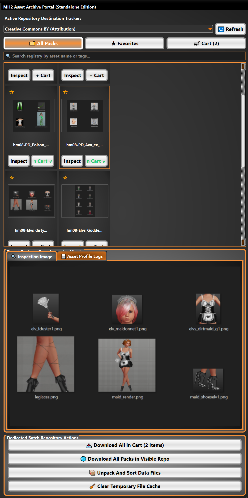

# MH2_Archive

A simple browser for the new creator portal upload submissions. A WIP.

 

MH2 Official Integrated Style Plugin- MH2_Archive.  This is a downloader for the github repository. 
  
Integrated/official plugin.
  
~>Please be aware this is not a stand-alone tool, it requires Makehuman 2 in order to load, to use this you install it in the mh2_official_tools folder,  
First open up makehuman 2, then pull down the community plugins menu in mh2(settings-community plugins), you should see the plugin panel open up to  
allow any installed extensions and plugins to be used. Enable the plugin. At present this should open it right up as a fully dockable window of its own.  

The folder name for this to operate is mh2_archive(needs to be exactly this!).

